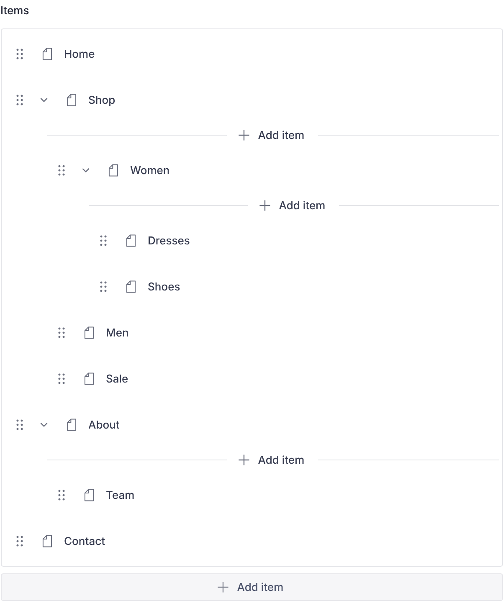

# sanity-plugin-sortable-tree

A sortable, nested tree input for Sanity array fields: drag items to reorder them and to nest
them under other items. Built for menus, navigation, page trees and other hierarchies that live
inside a single document.

<picture>
  <source media="(prefers-color-scheme: dark)" srcset="docs/tree.dark.png">
  
</picture>

- Drag to reorder and to change nesting, with a drag handle per item (pointer and keyboard).
- Items are edited in the Studio's own dialogs, with the schema's previews and initial values.
- Lists with several item types get a type menu on "Add item".
- Edit and Remove show on hover, on keyboard focus, and always on touch screens.
- "Add item" sits below the tree, like the Studio's own arrays. Each nested list starts with its
  own small "Add item" (like the blocks in Shopify's theme editor); items without children get an
  "Add nested item" action, shown with Edit and Remove.
- Invalid items are highlighted like the Studio's own array items, and a collapsed item shows its
  hidden children's errors.
- Long lists show their first items and "Show all N items", like the Studio's own arrays. Every
  list collapses on its own: the root and each item's nested items.
- Collapsed items and lists open when the Studio focuses something inside them (e.g. jumping to
  a validation error). The items you expand or collapse are remembered (in the browser) for the
  next time you open the document.
- Keyboard dragging: Space to pick up, up/down to move one position, left/right to change the
  nesting level, Space to drop, Escape to cancel.
- Edits are sent as targeted patches (`insert`/`unset` by `_key`), like the Studio's own array
  input, so concurrent edits by other people are kept.
- Respects read-only fields, documents and perspectives (published, releases). Read-only items
  still open, to read their fields, and read-only references still open their document.
- Nested items in `children`, or any field you name with `options.childrenField`.
- A `validateTreeDepth()` rule to flag items nested deeper than `maxDepth` (e.g. written
  through the API).
- Translatable, with an English locale bundle.

## Installation

```sh
npm install sanity-plugin-sortable-tree
```

### Compatibility

| sanity-plugin-sortable-tree | Sanity Studio | React   | @sanity/ui | @sanity/icons |
| --------------------------- | ------------- | ------- | ---------- | ------------- |
| 2.x                         | 6.x           | ≥ 19.2  | 4.x        | 5.x           |
| 1.x                         | 5.x           | 18 / 19 | 3.x        | 3.x           |

`sanity` already installs `@sanity/ui` and `@sanity/icons`, so you don't need to add them: the
plugin uses the Studio's own copies. On Sanity Studio v5, stay on 1.x:

```sh
npm install sanity-plugin-sortable-tree@^1
```

## Usage

Add the plugin in `sanity.config.ts` (or `.js`):

```ts
import {defineConfig} from 'sanity'
import {sortableTree} from 'sanity-plugin-sortable-tree'

export default defineConfig({
  // ...
  plugins: [sortableTree()],
})
```

Then turn on the tree for an array field with `options.tree`. Nested items live in a `children`
array field on each item (or another field, with `childrenField`), usually of the same type, which
makes the item type recursive:

```ts
import {defineArrayMember, defineField, defineType} from 'sanity'

export const menuItem = defineType({
  name: 'menuItem',
  title: 'Menu item',
  type: 'object',
  fields: [
    defineField({name: 'title', type: 'string'}),
    defineField({name: 'url', type: 'string'}),
    defineField({
      name: 'children',
      type: 'array',
      of: [defineArrayMember({type: 'menuItem'})],
    }),
  ],
  preview: {select: {title: 'title', subtitle: 'url'}},
})

export const menu = defineType({
  name: 'menu',
  type: 'document',
  fields: [
    defineField({name: 'title', type: 'string'}),
    defineField({
      name: 'items',
      type: 'array',
      of: [defineArrayMember({type: 'menuItem'})],
      options: {tree: true, maxDepth: 3},
    }),
  ],
})
```

Named array types work too:

```ts
defineType({
  name: 'menuTree',
  type: 'array',
  of: [defineArrayMember({type: 'menuItem'})],
  options: {tree: true},
})
```

The options are typed: with the plugin installed, `tree`, `maxDepth` and `childrenField`
autocomplete in `options` of any array field.

### Options

Set these in the array field's `options`:

| Option          | Type      | Default      | Description                                                             |
| --------------- | --------- | ------------ | ----------------------------------------------------------------------- |
| `tree`          | `boolean` | `false`      | Edit the array as a sortable tree.                                      |
| `maxDepth`      | `number`  | `3`          | How many levels deep items can be nested. `1` allows no nesting at all. |
| `childrenField` | `string`  | `'children'` | The field holding each item's nested items (see below).                 |

Sanity's own array options apply to the whole tree: `sortable: false` hides the drag handles, and
`disableActions: ['add']` / `['remove']` hide the Add and Remove buttons.

**Long lists:** like the Studio's own arrays, a list with more items than its limit shows the
first ones and "Show all N items" (then "Show fewer items"). Every list collapses on its own: the
root list and each item's nested items, counting only that list's own items. The limit is the
array field's `options.collapseItemsAfter`, the same option as the Studio's arrays: set it on the
tree field for the root list, and on the `children` field for nested lists. `false` never
collapses that list. Without it, the workspace's `form.arrays.collapseItems` applies (4 items by
default; `enabled: false` turns collapsing off everywhere).

```ts
defineField({
  name: 'items',
  type: 'array',
  of: [{type: 'menuItem'}],
  options: {tree: true, collapseItemsAfter: 8},
})

// In the item type: nested lists collapse after 5, or never with `false`
defineField({
  name: 'children',
  type: 'array',
  of: [{type: 'menuItem'}],
  options: {collapseItemsAfter: 5},
})
```

A list opens by itself when an item is added to it, or when the Studio focuses an item past its
limit. Dragging doesn't open lists: drop among the items that show, and the rest stay after them.

**Another field for nested items:** by default, nested items are in each item's `children` field.
To use another name, set `childrenField` on the tree field. It's the same field on every item type
that can have nested items:

```ts
defineType({
  name: 'sitemapPage',
  type: 'object',
  fields: [
    defineField({name: 'title', type: 'string'}),
    defineField({name: 'subpages', type: 'array', of: [{type: 'sitemapPage'}]}),
  ],
})

defineField({
  name: 'pages',
  type: 'array',
  of: [{type: 'sitemapPage'}],
  options: {tree: true, childrenField: 'subpages'},
})
```

### Validating the depth

The tree never nests items deeper than `maxDepth`, but data written through the API (or before
`maxDepth` was lowered) can be. Those items still show, so they can be moved up or removed. To
flag them, add `validateTreeDepth()` to the field's validation: each item that's too deep gets an
error on its own row (only the outermost one: its nested items move with it).

```ts
import {validateTreeDepth} from 'sanity-plugin-sortable-tree'

defineField({
  name: 'items',
  type: 'array',
  of: [defineArrayMember({type: 'menuItem'})],
  options: {tree: true, maxDepth: 3},
  validation: (rule) => rule.custom(validateTreeDepth()),
})
```

It reads `maxDepth` and `childrenField` from the field's options. To set them yourself, or reword
the error: `validateTreeDepth({maxDepth: 2, childrenField: 'subpages', message: (max) => ...})`.

### How the data is stored

The value is a plain Sanity array. Each item keeps its own fields; nested items are in its
`children` array:

```json
[
  {
    "_key": "a1",
    "_type": "menuItem",
    "title": "Shop",
    "children": [{"_key": "b2", "_type": "menuItem", "title": "Women"}]
  },
  {"_key": "c3", "_type": "menuItem", "title": "About"}
]
```

- Moving an item moves its children with it. Keys only need to be unique among siblings, so an
  item gets a new `_key` if it moves next to an item with the same key.
- An item with `collapsed: true` in its stored value starts out collapsed. Expanding and collapsing
  in the Studio doesn't change the document: the items you expand or collapse are remembered in
  your browser's local storage instead, per user, document and field, and win over
  `collapsed: true` the next time you open the document.
- Nested items the tree can't show (no `_key`, a repeated `_key`, or `children` that isn't an
  array) are left untouched, and a note under their parent says so. Open the parent item to fix
  them with the Studio's own tools.

### References

A tree can mix items with references to documents, at any depth: list the reference type in the
array's `of`, and in the `children` field's `of`:

```ts
const pageReference = defineArrayMember({type: 'reference', to: [{type: 'page'}]})

export const navItem = defineType({
  name: 'navItem',
  type: 'object',
  fields: [
    defineField({name: 'title', type: 'string'}),
    defineField({name: 'children', type: 'array', of: [{type: 'navItem'}, pageReference]}),
  ],
})

// In the document:
defineField({
  name: 'items',
  type: 'array',
  of: [defineArrayMember({type: 'navItem'}), pageReference],
  options: {tree: true},
})
```

**References are leaves.** A reference is just a pointer to another document, with no fields of
its own, so it can't hold `children` (the same as in Sanity's own data model). In the tree that
means:

- A reference row has no nested list and no "Add nested item" action.
- Nothing can be dropped into a reference. While dragging, a row pulled to the right of a
  reference stays its sibling. More generally, items only nest under item types with a
  `children` array field.
- References can be dragged anywhere a reference is allowed (the root, or any `children` array
  whose `of` includes the reference type) and reordered like any other row. Moving one keeps its
  `_ref`, `_weak` and `_strengthenOnPublish`.

References are edited in their row, without a dialog:

- A picked reference sits in the row like any other item, showing the referenced document's
  preview with its status (published, draft, changes), as in the Studio's reference input.
- Click it to open the document in a pane to the right (in the structure tool). The row stays
  selected while that pane is open. Its pencil (**Replace reference**) searches for another
  document: pick one to replace it, or press Escape (or click elsewhere) to keep the current one.
- An empty reference, for example one just added from the **Add item** menu, shows the search.
  Focusing it opens a popover listing the documents the reference can point to; typing narrows
  them down. Use the arrow keys and Enter, or click, to pick one. Adding a reference focuses its
  search, and leaving it without picking anything removes it again.
- The search is the Studio's own, as in its reference input: every type in `to`, each type's
  search configuration, the workspace's search strategy, the current perspective, and the
  reference type's `options.filter` (a GROQ string with `filterParams`, or a function).
- Weak reference types (`weak: true`) stay weak. Picking a document that only exists as a draft
  makes the reference weak until that document is published (`_weak` and
  `_strengthenOnPublish`), like the Studio's reference input.
- Validation (such as `rule.required()`, or a reference to a missing document) shows on the row
  like any other item's. A reference to a document that doesn't exist reads "Document
  unavailable".
- The row only picks existing documents. To make a new page, create it first.

**A link that needs children:** use a menu item with a reference _field_ plus `children`. It
nests like any other item:

```ts
export const navItem = defineType({
  name: 'navItem',
  type: 'object',
  fields: [
    defineField({name: 'title', type: 'string'}),
    defineField({name: 'link', type: 'reference', to: [{type: 'page'}]}),
    defineField({name: 'children', type: 'array', of: [{type: 'navItem'}, pageReference]}),
  ],
  preview: {
    select: {title: 'title', linkTitle: 'link.title'},
    prepare: ({title, linkTitle}) => ({title: title || linkTitle}),
  },
})
```

> The selected-reference box uses `SearchResultItemPreview` (marked `@internal` in Sanity 6.23)
> for the preview with status, and `usePaneRouter` from `sanity/structure` (`@beta`) to open the
> document in a pane, like the link picker plugin. Outside the structure tool the preview isn't a
> link.

### Using the input directly

The plugin applies the input to every array with `options.tree`. You can also set it on a single
field:

```ts
import {SortableTreeInput} from 'sanity-plugin-sortable-tree'

defineField({
  name: 'items',
  type: 'array',
  of: [defineArrayMember({type: 'menuItem'})],
  options: {tree: true},
  components: {input: SortableTreeInput},
})
```

Add the plugin to your config anyway: it registers the input's translations.

### Translations

The plugin's strings are in the `sortable-tree` locale namespace (exported as
`sortableTreeLocaleNamespace`). To translate or reword them, add a bundle for your locale:

```ts
import {defineConfig, defineLocaleResourceBundle} from 'sanity'
import {sortableTree, sortableTreeLocaleNamespace} from 'sanity-plugin-sortable-tree'

export default defineConfig({
  // ...
  plugins: [sortableTree()],
  i18n: {
    bundles: [
      defineLocaleResourceBundle({
        locale: 'nb-NO',
        namespace: sortableTreeLocaleNamespace,
        resources: {
          'add-item': 'Legg til',
          // ...see src/i18n.ts for every key
        },
      }),
    ],
  },
})
```

## Develop & test

This plugin uses [@sanity/plugin-kit](https://github.com/sanity-io/plugins/tree/main/packages/@sanity/plugin-kit)
and [@sanity/pkg-utils](https://github.com/sanity-io/pkg-utils) for building, oxlint for linting and
oxfmt for formatting.

```sh
npm run dev        # test Studio on http://localhost:3333 (offline, no Sanity project needed)
npm test           # unit tests (vitest)
npm run test:e2e   # end-to-end tests in the test Studio (needs `npm run dev` running)
npm run lint       # oxlint (with type checking)
npm run format     # oxfmt
npm run build      # verify the package and build dist/
```

The test Studio in `dev/` uses the plugin straight from `src/`. It talks to an in-memory stand-in
for the Content Lake (`dev/fake-lake`), so it runs without a project, login or network, and its
fixtures cover nested, empty, read-only, named, mixed-type, malformed, too-deep, custom
`childrenField` and 500-item menus.
`npm run screenshots <dir>` captures every scenario in light and dark mode, for reviewing visual
changes.

To try the plugin in another Studio, see
[Testing a plugin in Sanity Studio](https://github.com/sanity-io/plugins/tree/main/packages/@sanity/plugin-kit#testing-a-plugin-in-sanity-studio)
(`npm run link-watch`).

## Release

Releases are published to npm from GitHub Actions ([`publish.yml`](.github/workflows/publish.yml))
with npm provenance; don't run `npm publish` locally.

1. Describe user-facing changes in a changeset: `npm run changeset`, and commit the file with your
   PR.
2. To release, run `npx changeset version` in a PR. It bumps `"version"` in `package.json` and
   writes `CHANGELOG.md`.
3. Merge it to `main`. The publish workflow runs the checks, publishes that version to npm, and
   creates the `v<version>` tag and GitHub release.

Merges that don't change the version publish nothing. Versions with a pre-release suffix (e.g.
`2.1.0-beta.0`) are published under the `next` dist-tag.

## License

[MIT](LICENSE) © Dennis Regalado

The drag projection logic is adapted from the [dnd-kit](https://github.com/clauderic/dnd-kit)
sortable tree example (MIT).
